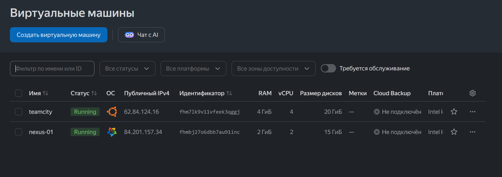
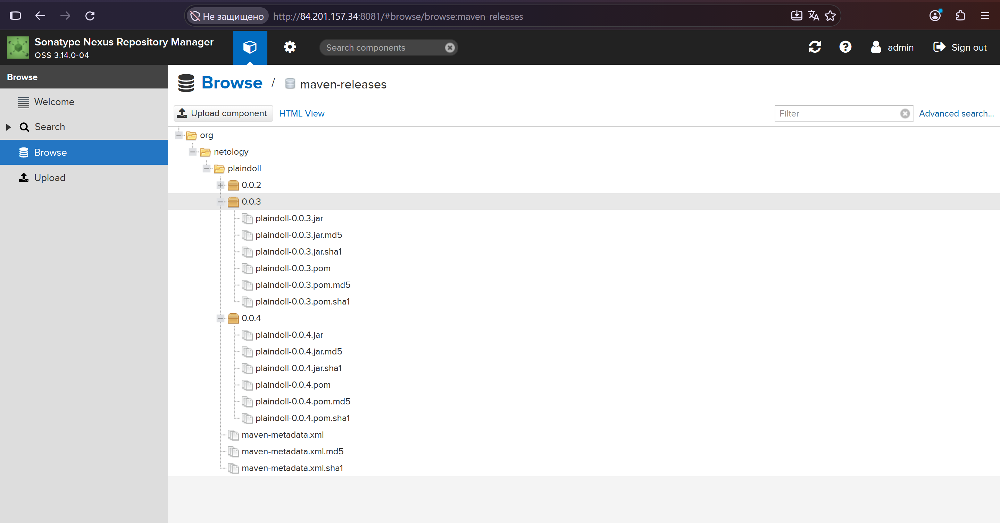
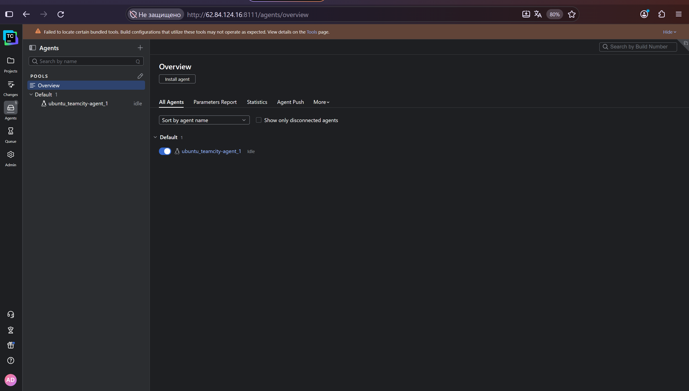
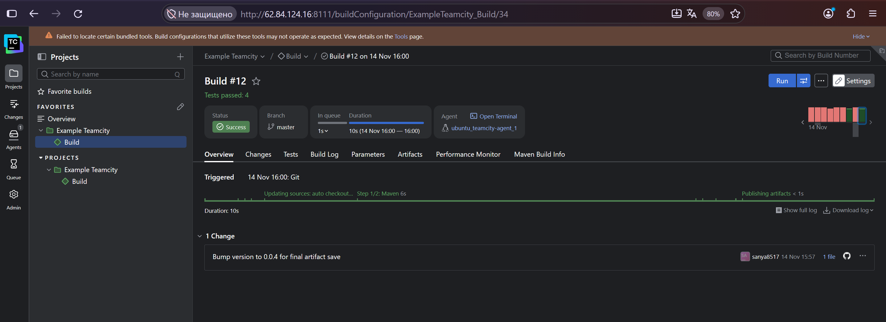
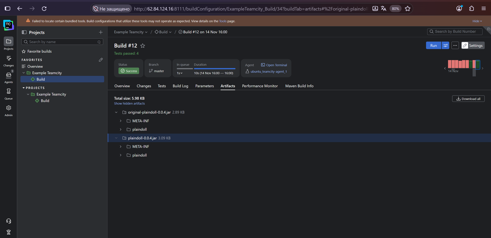

<b>Задание</b>

# Домашнее задание к занятию 11 «Teamcity»

## Подготовка к выполнению

1. В Yandex Cloud создайте новый инстанс (4CPU4RAM) на основе образа `jetbrains/teamcity-server`.
2. Дождитесь запуска teamcity, выполните первоначальную настройку.
3. Создайте ещё один инстанс (2CPU4RAM) на основе образа `jetbrains/teamcity-agent`. Пропишите к нему переменную окружения `SERVER_URL: "http://<teamcity_url>:8111"`.
4. Авторизуйте агент.
5. Сделайте fork [репозитория](https://github.com/aragastmatb/example-teamcity).
6. Создайте VM (2CPU4RAM) и запустите [playbook](./infrastructure).

## Основная часть

1. Создайте новый проект в teamcity на основе fork.
2. Сделайте autodetect конфигурации.
3. Сохраните необходимые шаги, запустите первую сборку master.
4. Поменяйте условия сборки: если сборка по ветке `master`, то должен происходит `mvn clean deploy`, иначе `mvn clean test`.
5. Для deploy будет необходимо загрузить [settings.xml](./teamcity/settings.xml) в набор конфигураций maven у teamcity, предварительно записав туда креды для подключения к nexus.
6. В pom.xml необходимо поменять ссылки на репозиторий и nexus.
7. Запустите сборку по master, убедитесь, что всё прошло успешно и артефакт появился в nexus.
8. Мигрируйте `build configuration` в репозиторий.
9. Создайте отдельную ветку `feature/add_reply` в репозитории.
10. Напишите новый метод для класса Welcomer: метод должен возвращать произвольную реплику, содержащую слово `hunter`.
11. Дополните тест для нового метода на поиск слова `hunter` в новой реплике.
12. Сделайте push всех изменений в новую ветку репозитория.
13. Убедитесь, что сборка самостоятельно запустилась, тесты прошли успешно.
14. Внесите изменения из произвольной ветки `feature/add_reply` в `master` через `Merge`.
15. Убедитесь, что нет собранного артефакта в сборке по ветке `master`.
16. Настройте конфигурацию так, чтобы она собирала `.jar` в артефакты сборки.
17. Проведите повторную сборку мастера, убедитесь, что сбора прошла успешно и артефакты собраны.
18. Проверьте, что конфигурация в репозитории содержит все настройки конфигурации из teamcity.
19. В ответе пришлите ссылку на репозиторий.

---

### Как оформить решение задания

Выполненное домашнее задание пришлите в виде ссылки на .md-файл в вашем репозитории.

-----
-----

<b>Ответ</b>

Домашнее задание к занятию 11 «Teamcity»

1. Подготовка инфраструктуры и работа с Docker

Для выполнения практической части задания были развернуты две виртуальные машины в Yandex Cloud (с помощью Terraform):

teamcity (4 vCPU, 4 RAM) — публичный IP 62.84.124.16.

nexus-01 (2 vCPU, 2 RAM) — публичный IP 84.201.157.34.

Использование Docker:
Вся инфраструктура приложений на виртуальных машинах была развернута с использованием контейнеризации:

На основном сервере запущен Docker-контейнер с TeamCity Server (образ jetbrains/teamcity-server).

Там же с помощью Docker Compose поднят контейнер с TeamCity Agent (образ jetbrains/teamcity-agent). Название агента ubuntu_teamcity-agent_1 наглядно демонстрирует, что он работает в Docker-среде. Агент был успешно подключен к серверу по IP-адресу и авторизован:

На второй виртуальной машине развернут Docker-контейнер с менеджером репозиториев Nexus.
> 📸 ** Развернутая инфраструктура:** 📸
> 

2. Сборка и деплой в Nexus

Была настроена интеграция TeamCity с Nexus. Пароли для авторизации переданы через загруженный конфигурационный файл settings.xml, а адрес целевого репозитория прописан в pom.xml (блок distributionManagement).

В настройках шагов сборки (Build Steps) реализована условная логика:

При пуше в ветку master выполняется команда clean deploy (с отправкой файла в Nexus).

При пуше в другие ветки выполняется команда clean test (только прогон тестов).

На скриншоте ниже видно, что финальная версия артефакта 0.0.4 успешно загружена в репозиторий maven-releases на сервере Nexus:
> 📸 ** Загрузка на Nexus:** 📸
> 

3. Работа с ветками, кодом и артефактами (CI/CD)

В ходе работы над проектом выполнены следующие задачи разработчика и DevOps-инженера:

Конфигурация TeamCity (Configuration as Code) мигрирована в GitHub-репозиторий в формате Kotlin (синхронизируется папка .teamcity).

В отдельной ветке feature/add_reply написан новый метод sayHunter() для класса Welcomer и добавлены соответствующие тесты.

Выполнено успешное слияние (Merge) тестовой ветки в master.

Версия продукта в pom.xml повышена до 0.0.4.

Финальная автоматическая сборка #12 после изменения версии завершилась успешно:

Также были изменены настройки Artifact paths (target/*.jar), благодаря чему собранный архив теперь сохраняется не только в удаленном Nexus, но и прикрепляется к результатам сборки внутри самого TeamCity:
> 📸 ** Агент в TeamCity** 📸
> 

> 📸 ** Результат Build в TeamCity** 📸
> 

> 📸 ** Результат Artifactы после Build в TeamCity** 📸
> 

-----
-----
